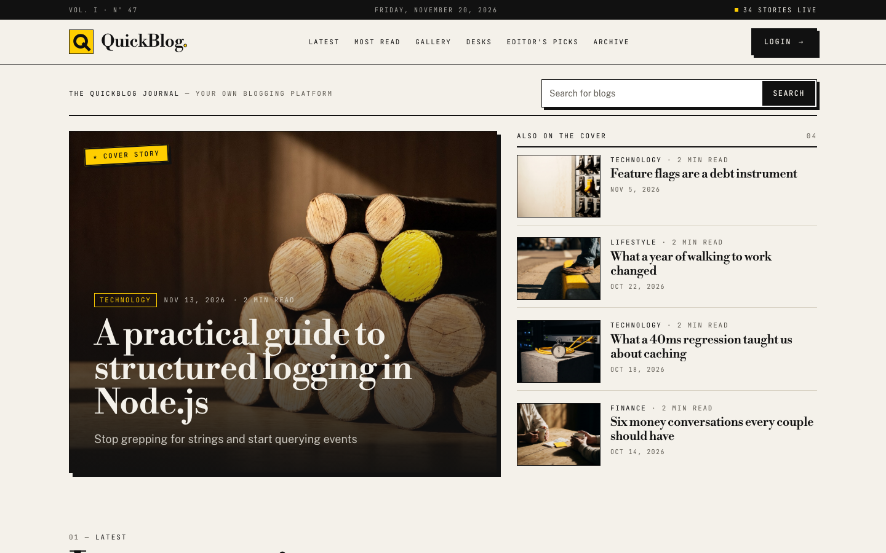
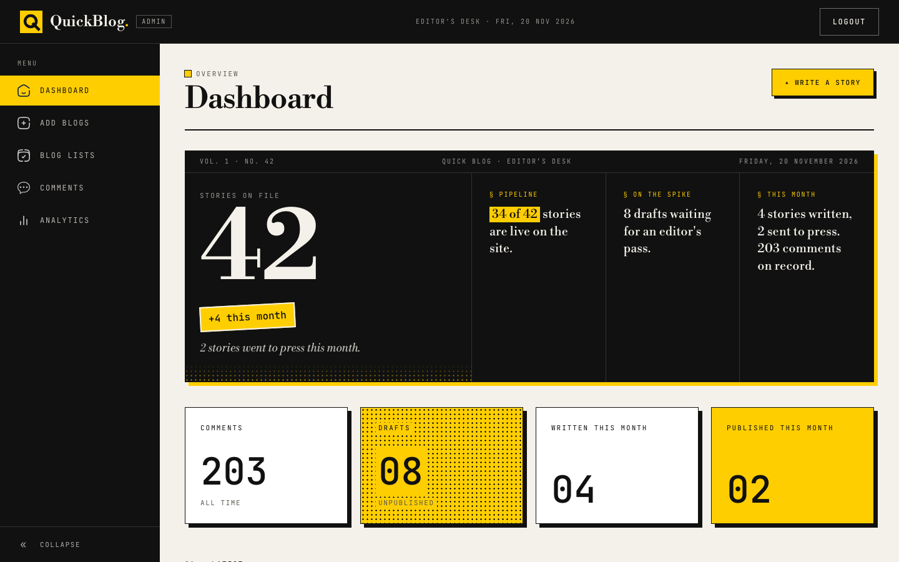

# QuickBlog



QuickBlog is a full-stack demo blog with an editorial, newspaper-style design: a public
front page (cover story, latest, gallery, desks, editor's picks, archive),
long-form article pages with comments, and an admin "Editor's desk" for writing,
publishing and moderating — with optional AI drafting through Google Gemini.

It is the reference project for live demos of AI-assisted development with Claude Code:
spec-driven work, subagents, skills and systematic debugging.

| | |
|---|---|
| **Client** | React 19, Vite 6, Tailwind CSS 4, React Router 7, motion — [`client/`](client/README.md) |
| **Server** | Express 5, MongoDB 7 (Mongoose 8, Docker), JWT, Multer, Gemini — [`server/`](server/README.md) |

## Quick start

```bash
cd server && npm i && cp .env.example .env && npm run setup && npm run server
cd client && npm i && cp .env.example .env && npm run dev
```

Open http://localhost:5173 (admin at `/admin`, `admin@quickblog.com` / `admin123`).
Full setup, environment variables and troubleshooting: [docs/getting-started.md](docs/getting-started.md).



## Documentation

| Where | What |
|-------|------|
| [docs/](docs/README.md) | Map of all docs, architecture, getting started, image prompts, flows |
| [specs/](specs/README.md) | Feature specs with EARS acceptance criteria — the contract for every feature |
| [client/docs/](client/docs/README.md) | UI: design system, motion, components, pages, data layer, testing |
| [server/docs/](server/docs/README.md) | Backend: API reference, data model, auth & security, seeding, uploads, testing |
| `AGENTS.md` (root and each folder) | Rules for AI coding agents, read by Claude Code and other agents |

## Demos

Step-by-step workshop scenarios in [docs/demos/](docs/demos/):

| Demo | Shows |
|------|-------|
| [Blog creation](docs/demos/blog-creation.md) | Plan mode + design reference → editor page with Quill, uploads and AI drafting |
| [Comments feature](docs/demos/comments-feature.md) | Plan mode from a screenshot → admin moderation page |
| [Debugging](docs/demos/debugging.md) | `systematic-debugging` skill on two bugs planted on the `demo-debugging` branch |

## Contributing

Read [AGENTS.md](AGENTS.md) first. In short: update the spec with the behavior, keep
`client/` and `server/` separate, follow the design system, and use `/commit` and
`/create-pr` for git.
