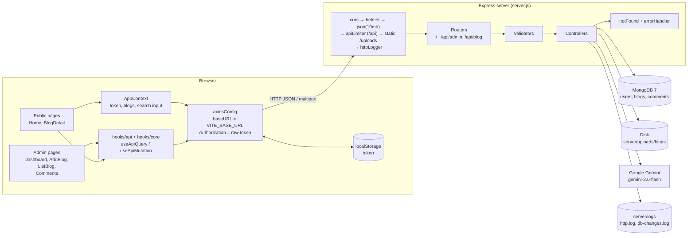
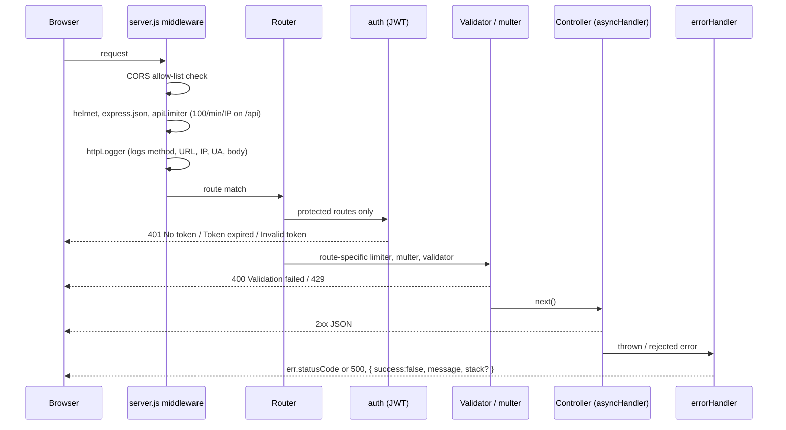

# QuickBlog — Architecture

> System-level overview. Package details live in [`client/docs/`](../client/docs/README.md) and [`server/docs/`](../server/docs/README.md); feature behavior lives in [`specs/`](../specs/README.md). Verified against `chore/editorial-redesign-docs` (2026-11-21).

## 1. System overview

QuickBlog is a two-package monorepo:

| Package | Stack | Entry point |
|---------|-------|-------------|
| `client/` | React 19, Vite 6, Tailwind CSS 4, React Router 7, Axios, Quill 2, marked, moment, motion, react-hot-toast | `client/src/main.jsx` |
| `server/` | Express 5, Mongoose 8, jsonwebtoken, bcryptjs, multer 2, helmet, cors, express-rate-limit, `@google/genai` | `server/server.js` (runtime), `server/src/app.js` (test app) |

Everything is ES modules (`"type": "module"`). The client talks to the server only over HTTP (`VITE_BASE_URL`).

### Request pipeline (server.js)

## 2. Package structure

| Topic | Client | Server |
|-------|--------|--------|
| Folder map and conventions | [`client/AGENTS.md`](../client/AGENTS.md) | [`server/AGENTS.md`](../server/AGENTS.md) |
| Routes / pages | [`client/docs/pages.md`](../client/docs/pages.md) | [`server/docs/api.md`](../server/docs/api.md) |
| Components / data model | [`client/docs/components.md`](../client/docs/components.md) | [`server/docs/data-model.md`](../server/docs/data-model.md) |
| Data flow | [`client/docs/data-layer.md`](../client/docs/data-layer.md) | [`server/docs/auth-and-security.md`](../server/docs/auth-and-security.md) |
| Design / storage | [`client/docs/design-system.md`](../client/docs/design-system.md), [`motion.md`](../client/docs/motion.md) | [`server/docs/uploads-and-images.md`](../server/docs/uploads-and-images.md) |
| Seed data | — | [`server/docs/seeding-and-fixtures.md`](../server/docs/seeding-and-fixtures.md) |
| Testing | [`client/docs/testing.md`](../client/docs/testing.md) | [`server/docs/testing.md`](../server/docs/testing.md) |

## 3. Auth model

- Login: `POST /api/admin/login` finds `User` with `{ email, isActive: true }`, `bcrypt.compare`, signs JWT `{ userId, email, name, role }` with `JWT_SECRET`, `expiresIn: '7d'`.
- Roles: `admin` and `author` exist in the model and seed. **Both can log in and both get full access** to every protected route (admin panel, blog CRUD, moderation): the server never checks `req.user.role`.
- Client keeps the token in `localStorage.token` and `AppContext.token`; no expiry check client-side; logout is client-only (token is not revoked).

See [`specs/admin/auth.md`](../specs/admin/auth.md) and [`server/docs/auth-and-security.md`](../server/docs/auth-and-security.md).

## 4. External services

| Service | Where | Notes |
|---------|-------|-------|
| Google Gemini (`@google/genai`) | `server/src/configs/gemini.js` | Model `gemini-2.0-flash`; client created at module load with `GEMINI_API_KEY`; returns `response.text` |
| MongoDB 7 (Docker) | `server/docker-compose.yml` | Port 27017, volumes `mongodb_data`, `mongodb_config`, init scripts in `init-scripts/` |
| mongo-express | `server/docker-compose.yml` | Port 8081, basic auth = DB user |
| Google Fonts | `client/src/index.css` | Libre Bodoni, Public Sans, JetBrains Mono |
| Local disk | `server/uploads/` | Image storage (no ImageKit/CDN in this branch) |
| Vercel | `server/vercel.json`, `client/vercel.json` | Deployment configs (server routes all to `server.js`; client SPA rewrite) |

## 5. Environment, scripts, setup

See [getting-started.md](getting-started.md) (env tables, scripts, troubleshooting) and the package READMEs.

## 6. Known gaps

Defects are tracked next to the behavior they affect: the **Known gaps** section of each spec in [`specs/`](../specs/README.md) and of each package doc. The most severe cross-cutting ones are summarized in [`specs/README.md`](../specs/README.md#cross-cutting-known-gaps).
